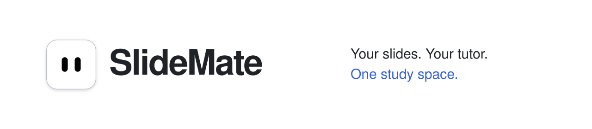
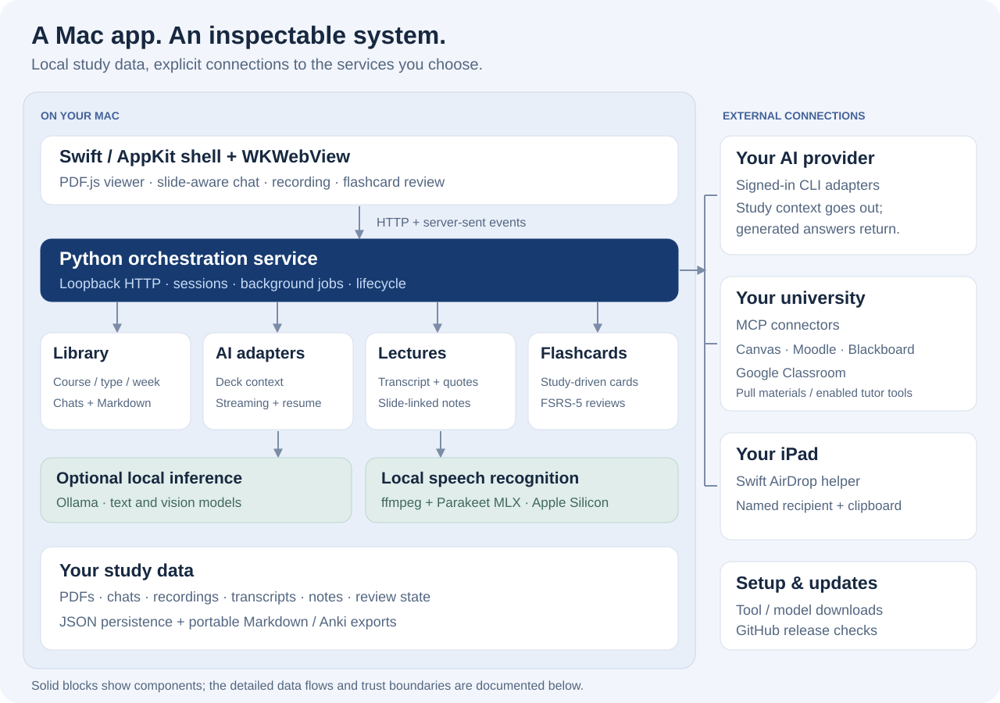

<p align="center">
  <picture>
    <source media="(prefers-color-scheme: dark)" srcset="docs/media/hero-v3-dark.svg">
    
  </picture>
</p>

<h1 align="center">SlideMate — your all-in-one AI study app for Mac</h1>

<p align="center">
  <strong>From the university dashboard to the exam. One place to study.</strong><br>
  Pull your slides. Ask your tutor. Send to iPad. Turn lectures into revision.
</p>

<p align="center">
  <a href="https://github.com/Mattlo0546/slidemate/releases/latest"></a>
  
  <a href="LICENSE"></a>
</p>

<p align="center">
  <a href="#a-study-day-with-slidemate">Explore the features</a> ·
  <a href="#get-started">Get started</a> ·
  <a href="#architecture">See the architecture</a> ·
  <a href="#questions-students-ask">FAQ</a>
</p>

**SlideMate is a free, open-source macOS study app that brings an AI slide tutor, university slide downloads, one-click AirDrop to iPad, lecture transcription, and spaced-repetition flashcards into one workflow.** The tutor uses the lecture deck, the slide in front of you, and available lecture notes to explain what you are studying. Sign in with a supported AI account—there is **no additional SlideMate subscription or API key to buy**. Your provider's access rules and usage limits still apply; a local Ollama model is another option.

The point is convenience: fewer downloads to organise, fewer windows to juggle, and less work turning a lecture into something you can revise.

<p align="center">
  
</p>

## A study day with SlideMate

<table>
<tr>
<td width="50%" valign="top">

### Before class: your slides, already organised
Connect **Moodle, Blackboard, Canvas or Google Classroom**. SlideMate pulls course materials into your library and groups PDFs by **course, type and week**. After setup, **Pull** fetches new materials. You can also drop in your own PDFs.

Less time navigating the university dashboard. More time getting started.

</td>
<td width="50%" valign="top">

### In class: straight to your iPad
Send a whole slide, a snip, or part of a tutor answer to your iPad through **AirDrop**. Set your iPad's name once and enable auto-select to skip hunting through a room full of devices. Clipboard copy also works with Universal Clipboard.

Ready for your **Goodnotes or Notability** workflow.

</td>
</tr>
<tr>
<td valign="top"></td>
<td valign="top"></td>
</tr>
<tr>
<td width="50%" valign="top">

### When something doesn't click: ask
Press **E** to explain the current slide, or ask your own question. The tutor gets deck context and knows which slide you mean. Answers link back to slides. Attach a photo of handwritten notes, follow up, and revisit the conversation beside the same slide later.

Your existing AI account, right inside your study space.

</td>
<td width="50%" valign="top">

### After class: the lecture becomes notes
Record a lecture, tutorial or seminar on your Mac. **On-device Parakeet transcription** turns the audio into text; your selected AI writes a summary and notes for the slides discussed, with transcript quotes. Already have a transcript? Import it, including timed lecture-capture captions.

The explanations between the bullet points stay with the deck.

</td>
</tr>
<tr>
<td width="50%" valign="top">

### Before the exam: revise what challenged you
Flashcards draw on the **slides, lecture notes and questions you asked the tutor**. Cards are grouped by subtopic, with exam hints and source slides. **FSRS spaced repetition** schedules reviews across courses. Export Basic and Cloze cards to Anki when you want.

Your revision follows what you actually needed help with.

</td>
<td width="50%" valign="top">

### Throughout: a proper slide workspace
Search the deck with **⌘F**, pinch to zoom, select PDF text, and keep chats beside the relevant slide. Chats, notes and cards can be written as **Markdown** alongside your materials.

Your library and study history live on your Mac.

</td>
</tr>
</table>

<details>
<summary><strong>Watch lecture notes and the PDF viewer</strong></summary>

| Notes linked to slides | Zoom and search |
| --- | --- |
|  |  |

The demos use an original sample lecture. Tutor answers were generated with Claude. Thinking time is shortened; the AirDrop destination in the snipping demo is illustrated. [Demo production notes](docs/demo/README.md).

</details>

## Get started

1. **Download SlideMate** from the [latest release](https://github.com/Mattlo0546/slidemate/releases/latest). Open the ZIP or DMG supplied with that release and move SlideMate to Applications.
2. **Choose your AI and sign in.** The welcome flow helps install and connect supported providers. You do not need a separate SlideMate account.
3. **Connect your university or open a PDF.** Let SlideMate pull and organise your course materials, then open a slide and start asking questions.

**Requirements:** macOS 13 or later, on Apple Silicon or Intel. Local audio transcription requires **Apple Silicon** and the Parakeet model download. iPad auto-select requires the AirDrop helper's Accessibility permission and your device name.

> **Release status:** the current download is **v0.5.0**, distributed as a ZIP. This README describes current `main`; university search, the expanded connector directory and DMG packaging include changes newer than that release. [Release notes](https://github.com/Mattlo0546/slidemate/releases) show what is in each download. [Build from source](docs/getting-started.md#build-from-source) for the latest code.

[Installation and first launch →](docs/getting-started.md) · [AI accounts and local models →](docs/getting-started.md#choose-your-ai) · [University setup →](docs/getting-started.md#connect-your-university)

## Why the whole workflow matters

You can upload a PDF to a general chatbot. SlideMate makes the surrounding study work part of the same app:

| The job | What SlideMate connects |
| --- | --- |
| Get ready for a lecture | University connector → course library → organised PDFs |
| Understand an equation or diagram | Current slide + deck context + available lecture notes → tutor answer |
| Annotate on an iPad | Slide or snip → named AirDrop recipient + clipboard |
| Capture an unrecorded session | Microphone → local transcript → summary and slide-linked notes |
| Catch up from a transcript | Imported text or timed captions → notes beside the relevant slides |
| Prepare for an exam | Slides + lecture notes + your questions → flashcards → scheduled reviews |

**The advantage is the connection between these steps.** You keep studying in the same place as your materials move from lecture to revision.

## Architecture

SlideMate combines a **Swift/AppKit macOS shell**, a **local Python service**, and a **PDF.js study interface**. Provider adapters reuse signed-in AI CLIs; MCP connectors bridge the university dashboard; lecture processing feeds both the tutor and flashcards.

<picture>
  <source media="(prefers-color-scheme: dark)" srcset="docs/media/architecture-dark.svg">
  
</picture>

| Engineering decision | Why it matters | Explore the implementation |
| --- | --- | --- |
| **Deck-aware provider sessions** | Prime context once where supported, resume follow-ups, stream answers and tool activity through server-sent events. | [providers.py](server/providers.py), [server.py](server/server.py) |
| **Transcript-grounded notes** | The model selects transcript line ranges; the app reconstructs quotes from the stored transcript and retains timestamps. | [lecture.py](server/lecture.py) |
| **Bounded audio processing** | One transcription job at a time, 15-minute segments, live partial transcripts and recovery after interruption. | [lecture.py](server/lecture.py) |
| **Separate university permissions** | Tutor tool access and the library's Pull action can be enabled independently. Background sync jobs are polled to completion. | [mcp.py](server/mcp.py), [university.py](server/university.py) |
| **Revision driven by study activity** | Finished lecture notes trigger cards; later tutor questions can add targeted cards. FSRS-5 maintains review state. | [flashcards.py](server/flashcards.py) |
| **Native Mac integration** | A Swift shell owns the local process, file opening and updates; a separate helper handles AirDrop recipient selection. | [main.swift](macos/SlideMate/main.swift), [airdrop.swift](macos/AirDrop/airdrop.swift) |

**[Read the architecture deep dive →](docs/architecture.md)** — component map, tutor sequence, lecture pipeline, persistence, trust boundaries and trade-offs. The goal is an inspectable system: follow a student action through the code to the saved result.

## Your data and your AI

PDFs, recordings, chats, notes and review history are stored locally. **Local storage does not mean cloud AI never sees your materials.** With a cloud provider, the app sends the context needed for the task: deck content, questions, slide images, attached pictures, and relevant notes or transcripts. Connected university tool results may also enter that conversation.

Audio transcription runs locally through Parakeet. With a local Ollama model, tutoring and generation can run on your Mac too; initial downloads, university connections and update checks still use the network. [Data flow and limitations](docs/architecture.md#data-and-trust-boundaries).

## Questions students ask

### What is SlideMate?
SlideMate is an all-in-one AI study app for Mac. It combines a lecture PDF viewer, context-aware AI tutor, university material downloads, AirDrop to iPad, lecture transcription and FSRS flashcards. It is a study tool for existing slides, not a presentation generator.

### Is SlideMate free? Do I need another AI subscription?
SlideMate is free and MIT-licensed, with no SlideMate subscription. Sign in to a supported AI provider using an account that includes access to its CLI. Free-tier eligibility and usage limits are set by the provider. You can also use an Ollama model locally without a cloud AI subscription.

### Can the AI explain the whole lecture deck?
The tutor uses deck context together with the current slide and available lecture notes. Claude can receive the PDF directly; other adapters generally use extracted slide text plus the current slide image where supported. Large decks and local models have context limits. [How context is assembled](docs/architecture.md#the-tutor-path).

### How do I send a slide to Goodnotes or Notability on my iPad?
Use **Send to iPad** for a slide or snip. SlideMate opens AirDrop and can select the named iPad after you enable its helper. It also copies the image to the clipboard for Universal Clipboard. The iPad must be discoverable; receiving and importing still follow Apple's and your note app's normal behaviour.

### Does it automatically download my university slides?
Connecting a supported university starts a material pull. Later, press **Pull** to fetch new files. The library classifies downloaded PDFs by course, type and week. Access depends on the institution's setup and your account; Google Classroom needs an OAuth client file. This is not a promise of continuous background sync for every university.

### Can it help me catch up on a missed lecture?
Yes, when you have a transcript or timed captions: import them to generate a summary and slide-linked notes. For sessions you attend, record in SlideMate and transcription runs locally. **Automatic fetching and transcription of university-hosted lecture recordings is not part of the verified implementation documented here.**

### How are the flashcards personalised?
Cards use the lecture slides, available notes, exam hints and your tutor questions. After a revision conversation goes quiet, SlideMate can add cards about what you asked. Review in the app with FSRS or export Anki-compatible text. Generated cards remain editable.

### Is there an iPad, Windows or Linux version?
The app runs on macOS 13+. iPad is a destination for slides and snips; there is no standalone SlideMate iPad app in this repository. Windows and Linux are not currently supported.

## Build, explore, contribute

```bash
git clone https://github.com/Mattlo0546/slidemate.git
cd slidemate
scripts/install.sh
```

The installer builds and installs the app. For a separate development data folder, use `scripts/dev.sh`; for a bundle without installation, use `scripts/build-app.sh`. [Developer setup and checks](docs/architecture.md#development-and-validation).

Found a bug or a university that needs support? [Open an issue](https://github.com/Mattlo0546/slidemate/issues). Include the macOS version, SlideMate version and steps to reproduce; leave credentials and private course materials out. See [contribution guidance](CONTRIBUTING.md).

Built by [Matthew Lo](https://github.com/Mattlo0546). **MIT licensed** — see [LICENSE](LICENSE) and [third-party acknowledgements](THIRD_PARTY.md). [Plain-text product reference](llms.txt).
