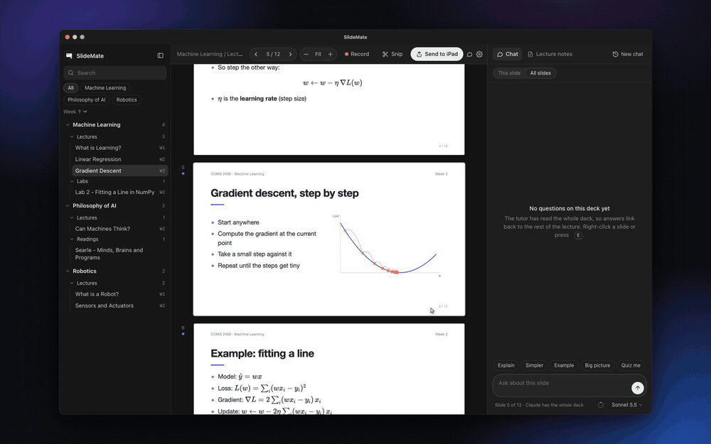
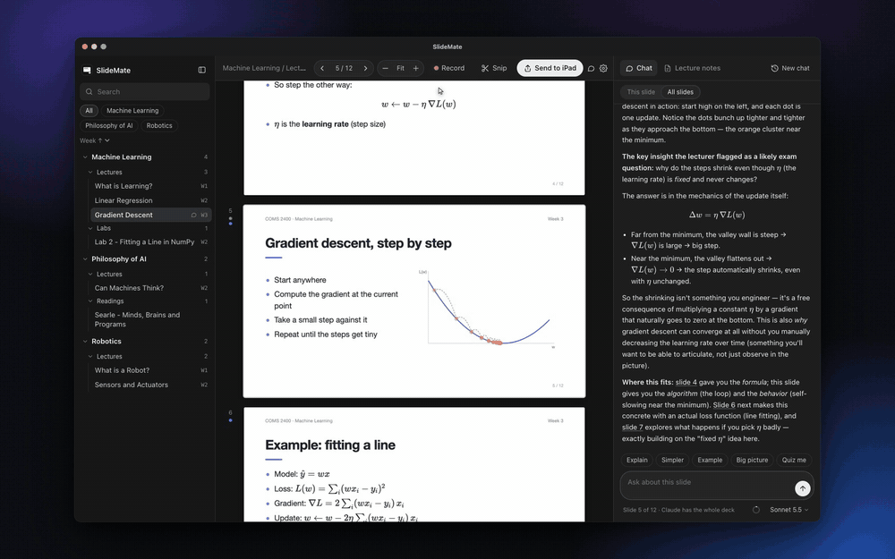
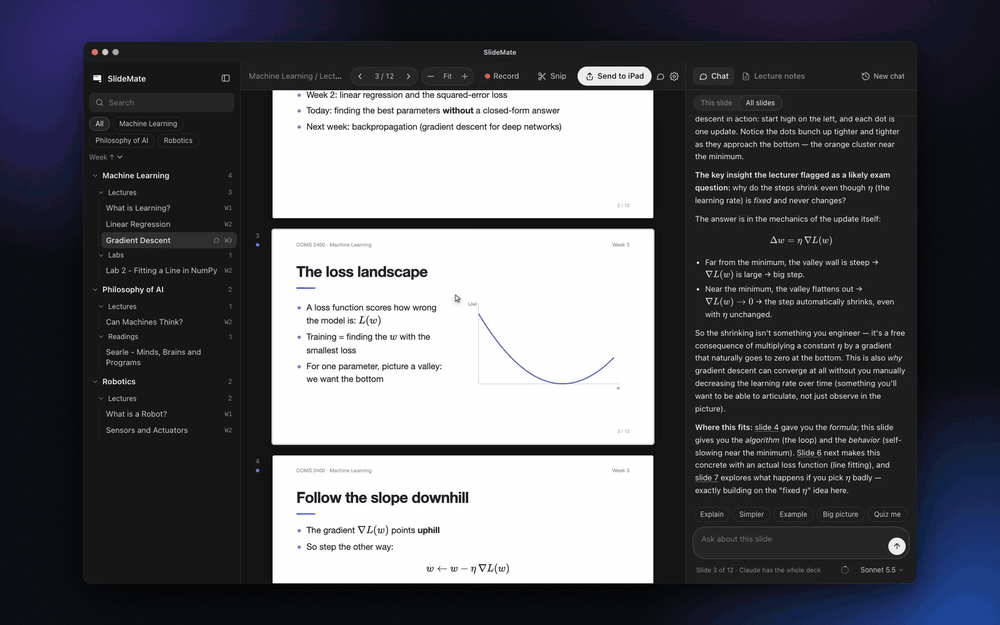
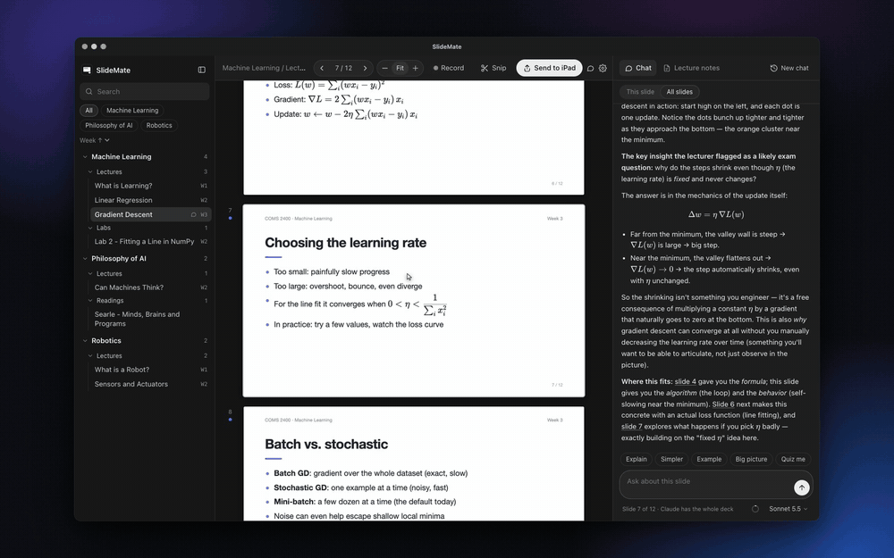

<div align="center">


# SlideMate

**Study your lecture slides with an AI tutor that has read the whole deck.**

Explain any slide in context · Snip it to your iPad in one click · Turn the lecture into notes for every slide

[](https://github.com/Mattlo0546/slidemate/releases/latest)   [](LICENSE)



</div>

**SlideMate is a free, open-source Mac app that explains lecture slides with AI.** It works with your Claude or ChatGPT account, or for free with a
Google account or a model running on your Mac.

Lecture PDFs are terse: a few bullets, a diagram, an equation. Pasting slides into a chatbot one at a time
loses the thread. **SlideMate** is a PDF viewer for lecture decks with a tutor that has read every slide and
the lecture itself (if you recorded it). Ask about the slide you're on, and the answer explains how it connects to the rest of
the course.

It runs locally on your Mac and uses the AI you already pay for: **Claude** (via Claude Code), **ChatGPT**
(via Codex), **Cursor** (via the Cursor CLI, with any model your Cursor plan offers) or **Grok** (via the Grok CLI).
No subscription? Use **Antigravity** (Google's CLI, free with a Google account) or a model that runs on your Mac with
**Ollama** ([free options](#using-it-for-free)). No API keys, no account, no server.

## What it does

### 🧠 A tutor that knows the whole deck
Right-click → **Explain this slide** (or press <kbd>E</kbd>), or ask anything. Answers draw on the entire deck and on what
your lecturer actually said. Slide references like "slide 4" are links: hover to preview, click to jump.

<table>
<tr>
<td width="50%" valign="top">

### 📲 Snip → iPad in one click
Drag over any part of a slide, or over the chat to grab the tutor's notes, and **Send to iPad**. It goes by AirDrop (SlideMate can pick your iPad for you) and is
copied to your clipboard, ready for GoodNotes or Notability.

</td>
<td width="50%" valign="top">

### 🎙️ Lecture → notes for every slide
Hit **Record** in class. SlideMate transcribes on-device with NVIDIA Parakeet (downloaded for you after setup on Apple
Silicon Macs), tracks which slide you were on, and writes
a summary (key ideas, to-dos, deadlines, exam tips) plus **notes for each slide with the lecturer's exact words**.

</td>
</tr>
<tr>
<td valign="top"></td>
<td valign="top"></td>
</tr>
<tr>
<td width="50%" valign="top">

### 🔍 Pinch, zoom, search
Pinch to zoom around the cursor, like Photoshop. <kbd>⌘F</kbd> searches the text of every slide, and you can select
and copy straight from the PDF.

</td>
<td width="50%" valign="top">

### 📚 Your courses, sorted
Point SlideMate at your uni folder. It sorts every PDF by **course → Lectures / Labs / Readings → week**, without moving
a single file. PDFs dropped onto the window get filed into the right course.

</td>
</tr>
<tr>
<td valign="top"></td>
<td valign="top"></td>
</tr>
</table>

### 🃏 Flashcards that know what was hard
After each lecture, SlideMate writes active-recall flashcards for it, split by subtopic. They come from the slides and
from **what the lecturer said**, so anything flagged as examinable is marked ⭐. They also come from **the questions you
asked the tutor**: what you struggled with gets its own card. When you've been revising a deck in the chat, new cards
are added for the bits you asked about.

Review with spaced repetition. **FSRS**, the scheduler Anki uses, brings each card back just before you'd forget it.
"Study everything due" mixes your courses, and the back of each card shows the slide it came from. Cards adapt to the
subject: arguments and objections for philosophy, mechanisms and trade-offs for engineering, formulas, derivation
steps and short problems for maths. Press <kbd>R</kbd> to review, and export any deck to Anki.

### And also
- **Chats saved per slide**: revisit a slide before the exam and your questions are still there. Also saved as Markdown
  (handy for Obsidian).
- **Your university, built in**: connect Moodle or Blackboard with just its address (Settings → Your university). A
  **Pull** button brings in new slides, and the tutor can check deadlines and announcements mid-answer. Other MCP
  servers (Canvas, [Google Classroom](https://github.com/Mattlo0546/classroom-mcp)…) go under Advanced.
- **Model and effort picker**, plus a usage ring showing how much of your plan you've used, just like in Claude.
- **Updates itself**: when a new release is out, SlideMate offers to install it and relaunch (or SlideMate → Check for
  Updates…).
- **Private by design**: everything stays on your Mac. The only thing sent anywhere is your question to the AI provider you
  chose (plus a daily check of GitHub for a new release, which sends nothing about you).

> The demo above uses an original sample lecture made for SlideMate. Answers are real, generated live by Claude.

## SlideMate vs. pasting slides into a chatbot

| | SlideMate | ChatGPT / Claude chat | NotebookLM-style tools |
| --- | --- | --- | --- |
| Knows the whole deck | Yes, every slide | Only what you paste | Yes |
| Knows which slide you're on | Yes | No | No: you chat with the whole source |
| Uses what the lecturer said | Yes, from your recording | No | If you upload a transcript |
| Slide → iPad in one click | Yes (AirDrop + clipboard) | No | No |
| Chats saved per slide | Yes | One long chat | One notebook chat |
| Flashcards from the lecture + your questions | Yes, spaced repetition (FSRS) | No | Generic flashcards |
| Where it runs | On your Mac (open source) | Web | Web |
| Cost | Free; uses your existing AI plan, a free Google account, or a model on your Mac | Your plan | Varies |

## Quick start

**Option A: download.** Grab `SlideMate-x.y.z-macOS.zip` from the
[latest release](https://github.com/Mattlo0546/slidemate/releases/latest) and drag SlideMate into Applications
(see the [first-launch note](#download)).

**Option B: build it yourself** (it opens without any Gatekeeper prompts):

```bash
git clone https://github.com/Mattlo0546/slidemate.git && cd slidemate && scripts/install.sh
```

Either way you need one AI to tutor you: a Claude, ChatGPT, Cursor or Grok plan, a Google account (Gemini through
Antigravity, free plan included), or a free model on your Mac with Ollama. The setup screen installs whichever you pick
and signs you in with one click. Nothing else to install: SlideMate brings its own Python.

---

## Download

Get **SlideMate-x.y.z-macOS.zip** from the [latest release](https://github.com/Mattlo0546/slidemate/releases/latest).
Unzip it and drag **SlideMate** into Applications. It runs on Apple Silicon and Intel Macs with macOS 13 or later.

The app isn't notarised by Apple yet, so the first time you open it macOS will block it:
- **macOS 15 (Sequoia) and later:** try to open it, then go to System Settings → Privacy & Security, scroll down
  and click **Open Anyway**.
- **macOS 13–14:** right-click SlideMate → **Open** → **Open**.
- **Or in Terminal:** `xattr -dr com.apple.quarantine /Applications/SlideMate.app`

You only do this once. From 0.3.0 on, SlideMate checks GitHub once a day and offers **Install and Relaunch** when a new
version is out, so later updates open without the prompt. Choose SlideMate → **Check for Updates…** to check now.

You'll also need:
- **One AI tutor**: Claude Code, Codex, Cursor CLI, Grok CLI or Antigravity CLI signed in, or Ollama with a model. The
  setup screen installs and signs in to any of them with one click (see the table below).
- **Lecture recording** needs an Apple Silicon Mac. SlideMate downloads speech-to-text (Parakeet, about 2 GB) by itself
  after setup.
- **Optional:** `brew install poppler` for slide text with every provider except Claude.

## Install from source

Requirements: macOS 13+, [Homebrew](https://brew.sh), and one of Claude Code, Codex, Cursor CLI, Grok CLI or
Antigravity CLI signed in (or Ollama with a model).

```bash
git clone https://github.com/Mattlo0546/slidemate.git
cd slidemate
scripts/install.sh
```

The installer adds `poppler` and `ffmpeg`, plus `parakeet-mlx` on Apple Silicon. It then builds `SlideMate.app`,
copies it to Applications and opens it. A setup screen asks for your slides folder (or creates one for you) and your
AI provider. It shows whether each provider is installed and signed in, and has a **Sign in** button.

Because the app is built on your Mac, it opens normally. If you instead download a prebuilt copy, macOS will ask you
to right-click → Open the first time, since it isn't notarised.

**AI provider (pick one or more):**

| Provider | Install | Sign in |
| --- | --- | --- |
| Claude | `curl -fsSL https://claude.ai/install.sh \| bash` | `claude auth login` (Pro/Max account) |
| ChatGPT | `brew install codex` | `codex login` (ChatGPT account) |
| Cursor | `curl https://cursor.com/install -fsS \| bash` | `cursor-agent login` (Cursor account) |
| Grok | `curl -fsSL https://x.ai/cli/install.sh \| bash` | `grok login` (grok.com / SuperGrok account) |
| Antigravity | `curl -fsSL https://antigravity.google/cli/install.sh \| bash` | run `agy` once and sign in with Google |
| On your Mac | `brew install --cask ollama-app` | no sign-in: `ollama pull qwen3-vl:8b` downloads a model |

SlideMate runs these CLIs on your behalf with your own subscription. Check each provider's terms for your plan.

### Using it for free

Claude Code needs a paid Claude plan, but you don't need one to use SlideMate:

| Option | What you need | Good to know |
| --- | --- | --- |
| **Antigravity** (Google) | A Google account | The free plan has a weekly limit (Google doesn't publish the number). Gemini Flash, plus Claude and GPT-OSS models where your plan includes them. Fast, and reads the slide image. |
| **ChatGPT Free** | A free ChatGPT account, with Codex | OpenAI includes Codex on the Free plan, with tight limits. |
| **On your Mac** (Ollama) | 16 GB of memory or more, and about 6 GB of disk for `qwen3-vl:8b` | Free, offline and private. The first question on a deck takes a minute or so while it reads the slides, and answers are simpler than the big models'. No MCP tools. |

## How your files are organised

```
Uni/                      ← the folder you choose in setup
├── Robotics/             ← each sub-folder is a course
│   ├── Week 01/...pdf
│   └── Lectures (SlideMate)/   ← lecture summaries, slide notes, transcripts (Markdown)
├── Philosophy of AI/
│   ├── SlideMate Chats/        ← your tutor chats (Markdown)
│   └── SlideMate Flashcards/   ← each lecture's flashcards (Markdown, plus Anki exports)
└── _Inbox/               ← drop PDFs here and they get filed into the right course
```

SlideMate's own data lives in `~/Library/Application Support/SlideMate`: settings, chats, lecture recordings and
notes, flashcards and your review history. Screenshots you send to the iPad are saved in `~/Pictures/SlideMate`.

## Send to iPad auto-select

macOS has no silent AirDrop API, so SlideMate opens the AirDrop panel and clicks your iPad for you. To enable it,
open Settings, enter your iPad's AirDrop name, click **Enable auto-select**, and turn on **SlideMate AirDrop** under
System Settings → Privacy & Security → Accessibility. Without it, you click your iPad once in the panel.

## Your university (Moodle and Blackboard)

Settings → **Your university** (also step 3 of the welcome screen): enter your Moodle or Blackboard address and press
**Connect**. SlideMate installs the connection ([moodle-mcp](https://github.com/Mattlo0546/moodle-mcp) or
[blackboard-mcp](https://github.com/Mattlo0546/blackboard-mcp)) into its own folder with
[uv](https://docs.astral.sh/uv/), opens the university sign-in window (SSO + MFA), then pulls this year's slides into
your library, one folder per course. Later, the library's **Pull** button fetches only what's new, and the tutor can
check deadlines and announcements. Nothing needs Terminal, Homebrew or Apple's Command Line Tools.

## Other MCP connections

Settings → Your university → **Advanced** → *Import from other AI apps…* (Claude, Codex, Cursor, Grok and Antigravity), or *Add server…* with a command and arguments
(the same format as Claude Desktop's `mcpServers`).

- **Tutor**: when this is ticked, the tutor can call the server's tools mid-answer, and you'll see "Using
  blackboard › bb_upcoming…" while it works. With Claude, servers are passed via `--mcp-config` with their tools
  allowed. With Codex, they're passed as `-c mcp_servers.*` overrides with `default_tools_approval_mode="approve"`.
  With Cursor and Grok, SlideMate writes them into the session's own scratch folder (`.cursor/mcp.json` with an
  allow rule for their tools, or `.grok/config.toml`); shell commands and file edits stay off. With Antigravity, they go
  in the session folder's `.agents/mcp_config.json`. Antigravity only reads permission rules from its global
  `~/.gemini/antigravity-cli/settings.json`, so SlideMate adds an `mcp(<server>/*)` allow rule there for each tutor
  server and removes it again when you remove the server (rules you added yourself are left alone). Shell commands
  and web pages stay off, since headless Antigravity refuses anything that would need a permission prompt. Local
  models (Ollama) don't use MCP tools.
- **Pull**: if a server you add has a sync-style tool (e.g. `bb_sync`), SlideMate wires it to a **Pull from
  <Server>** button in the library automatically, with its sign-in tool (e.g. `bb_login`) used when the session
  has expired. Long syncs that run in the background are followed to the end by polling the matching
  `*_status` tool, and progress shows in the sidebar. You can change this under Settings → Your university → Advanced.
- **Credentials**: environment variables, such as API tokens, stay in `config.json`, which only you can read. They
  are never sent to the UI.

**Google Classroom:** use [classroom-mcp](https://github.com/Mattlo0546/classroom-mcp) (one Python file, no dependencies).
It adds a **Pull from Google Classroom** button that downloads class slides as PDFs, one folder per course, and lets
the tutor see upcoming assignments and announcements.

## FAQ

**How can I get AI to explain my lecture slides?**
Open the PDF in SlideMate, right-click a slide → *Explain this slide*. The tutor has read every slide in the deck
(and your lecture notes, if you recorded the lecture), so it explains how that slide fits the rest of the course.

**Why not just paste my slides into ChatGPT?**
Pasting slides one at a time loses the rest of the lecture, and asking about "page 23" of a long PDF is clumsy.
SlideMate keeps the whole deck in context, knows which slide you're on, and saves the chat for each slide.

**How do I get a slide from my Mac into GoodNotes or Notability on my iPad?**
Click **Send to iPad**, or snip part of a slide → *Send to iPad*. It goes by AirDrop (SlideMate can pick your iPad
for you) and is copied to the clipboard for pasting via Universal Clipboard.

**Can it turn a lecture recording into notes?**
Yes. Press **Record** in class. It transcribes on-device (NVIDIA Parakeet), tracks which slide was showing, and
writes a summary plus notes for each slide with the lecturer's exact words. You can also import an Otter or Granola
transcript, or have a tool send one in (e.g. lecture-capture captions) through `POST /api/lecture/import` with
timed `sentences`. With `fill_from`, an earlier lecture's slide notes are kept and only the slides it missed are filled.

**Is it free? Is there a NotebookLM alternative for lecture slides?**
SlideMate is free and MIT-licensed, and uses the Claude or ChatGPT plan you already have, with no API key. Without a
plan, it works with a free Google account (Antigravity) or a model on your Mac (Ollama). Unlike
general "chat with your sources" tools, it's a slide viewer first: the tutor answers about the slide in front of you,
with the whole deck as context.

**Windows? iPad app?**
Not yet. It's macOS 13+ (Apple Silicon and Intel), and sends slides to your iPad.

## How it works

SlideMate is a small local web app: a Python server (standard library only, on a Python bundled in the app) on
`127.0.0.1`, and a web UI using PDF.js, KaTeX and marked. `SlideMate.app` is a thin native window (WKWebView) that
starts the server and shows the UI.

| Piece | Where |
| --- | --- |
| Server, library, chats | `server/server.py`, `server/library.py` |
| AI providers (Claude Code / Codex / Cursor / Grok) | `server/providers.py` |
| MCP connections + client | `server/mcp.py` |
| Your university (Moodle / Blackboard) | `server/university.py` |
| Things SlideMate installs for itself (uv, Parakeet, ffmpeg) | `server/tools.py` |
| Lecture recording → notes | `server/lecture.py` |
| Flashcards + FSRS scheduling | `server/flashcards.py` |
| UI | `server/static/` |
| Native app (window, updater) + AirDrop helper | `macos/` |

The server only listens on localhost and requires a custom header on every API call, so web pages can't reach it.

## Development

```bash
scripts/dev.sh            # runs the server from source on http://127.0.0.1:8768 with a separate data folder
scripts/build-app.sh      # builds build/SlideMate.app
```

UI changes in `server/static/` only need a page refresh. `scripts/install.sh --build-only` runs the whole installer
without touching /Applications.

## Uninstall

Delete `SlideMate.app` from Applications. Your data is in `~/Library/Application Support/SlideMate` (settings, chats,
lecture notes and recordings), so delete that folder too if you want a clean slate. Your slide folders are never touched.

## License

MIT. Bundled third-party libraries are listed in [THIRD_PARTY.md](THIRD_PARTY.md).
