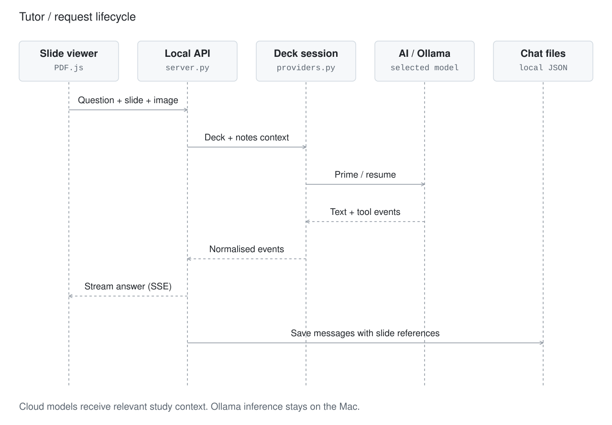
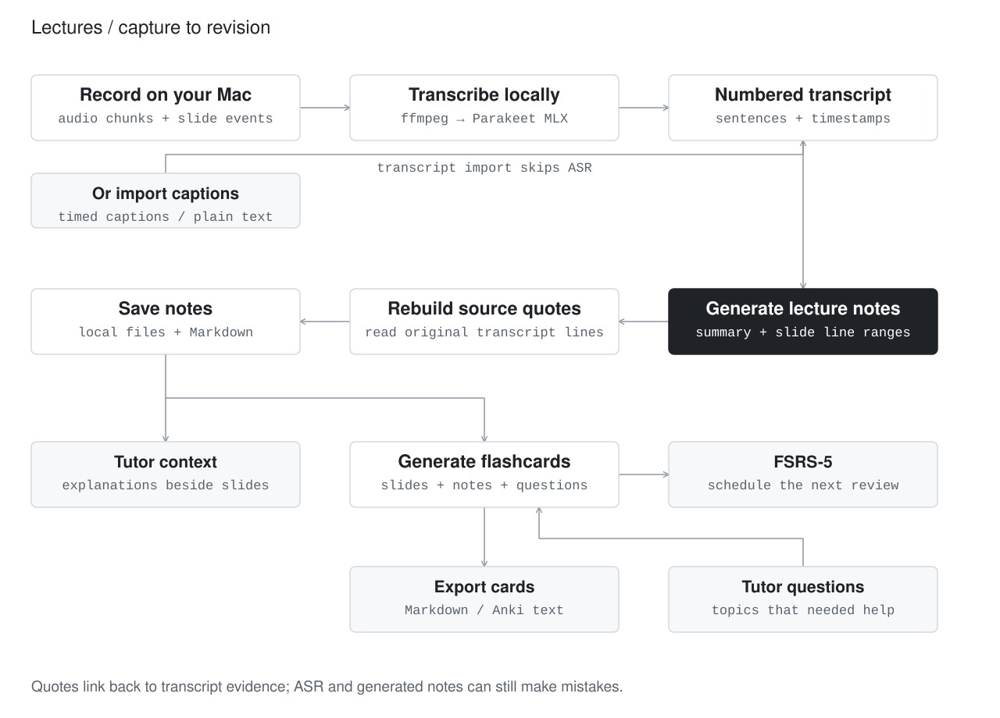

# SlideMate architecture

[← Product overview](../README.md) · [Setup guide](getting-started.md)

SlideMate is a local macOS study application: a Swift shell hosts a web interface and manages a Python service, which coordinates AI sessions, university connectors, lecture processing and revision. This document describes the implementation on `main`, reviewed on **20 October 2026**. It is an implementation map, not a claim that every integration has been tested against every provider or university.

## System map


[Editable system diagram source](diagrams/system.mmd).

The Python service uses the standard library. PDF rendering and maths run in the web UI. Speech recognition, PDF text extraction, AI CLIs and MCP connectors are separate dependencies; “standard-library server” does not mean the entire app has no dependencies.

## Code map

| Component | Responsibility | Source |
| --- | --- | --- |
| Native shell | Window lifecycle, local server process, file opening, native dialogs and updater | [macos/SlideMate/main.swift](../macos/SlideMate/main.swift) |
| Local API | Routing, chat streaming, session registry, background housekeeping | [server/server.py](../server/server.py) |
| Study interface | PDF viewing, slide-aware chat, recording controls, library and revision UI | [server/static/app.js](../server/static/app.js), [index.html](../server/static/index.html) |
| Provider layer | CLI invocation, context preparation, streaming events, cancellation, model and usage information | [server/providers.py](../server/providers.py) |
| AI setup | Guided installation and sign-in | [server/ai_setup.py](../server/ai_setup.py) |
| Library | Scanning, classification, inbox filing, sync, JSON chats and Markdown export | [server/library.py](../server/library.py) |
| University setup | Institution discovery, connector setup and permission switches | [server/university.py](../server/university.py), [directory](../server/static/universities.json) |
| MCP | Tool discovery/calls, provider configuration, sync/login detection and status polling | [server/mcp.py](../server/mcp.py) |
| Lectures | Audio chunks, transcription, slide events, notes, quotes and recovery | [server/lecture.py](../server/lecture.py) |
| Revision | Card generation/merging, review queues, FSRS-5, Markdown and Anki export | [server/flashcards.py](../server/flashcards.py) |
| Local setup | Data paths, settings and managed dependency installation | [server/config.py](../server/config.py), [server/tools.py](../server/tools.py) |
| iPad transfer | Native share panel and Accessibility-based recipient selection | [macos/AirDrop/airdrop.swift](../macos/AirDrop/airdrop.swift) |

## The tutor path

A question carries more than text. The API passes the **deck path, current slide number, rendered slide image, question and optional picture attachments** to the selected provider session. Available lecture notes and saved chat history supply additional context.



[Editable sequence diagram source](diagrams/tutor-sequence.mmd).

### Different providers, one interaction model

- **Claude:** a long-lived process per deck, with JSON streams on stdin/stdout. A reader thread queues output and drains stderr. The deck is sent on the initial turn. A native PDF is attached below 30 MiB and at most 100 pages; otherwise extracted text is used.
- **Codex, Cursor and Grok:** turn-based CLI calls resume the provider's conversation by ID. Initial context contains slide-numbered deck text; later turns carry the question and current-slide information. Image handling is adapter-specific.
- **Antigravity:** a separate adapter handles that CLI's conversation, image and permission conventions.
- **Ollama:** a local HTTP inference path with an in-memory message history, a constrained context budget and optional vision. Old follow-up exchanges are removed as the context fills; the initial deck exchange is retained. MCP tutor tools are not available on this path.

General extracted deck text is capped at **400,000 characters**, with a **600,000-character** Claude fallback. Ollama has its own smaller budget. A whole-deck workflow therefore does not imply unlimited context or perfect visual understanding of every page. Text extraction quality also depends on the PDF; scanned pages may not expose useful text.

### Lifecycle and failure handling

Each session has a lock, cancellation behaviour and a last-used time. Idle sessions are reaped. A provider change or changed session configuration can require a new session. Notes carry a version so a running conversation can receive newly generated lecture context.

The API emits `text/event-stream` updates. If the view disconnects, it continues consuming the current answer so the result can still be persisted. Provider adapters expose activity/usage events where the provider supports them. Claude's reader distinguishes retry activity from a silent process, reducing premature timeouts during provider backoff.

The Swift shell owns the server process. A parent-PID watcher and shutdown cleanup help avoid leaving the local service and provider processes behind after the app exits. These are process-lifecycle controls, not a claim of crash-proof execution.

## The lecture-to-revision path



[Editable pipeline diagram source](diagrams/lecture-pipeline.mmd).

### Memory and recovery

Audio arrives in chunks and is saved locally. Partial transcription runs during recording, approximately every 45 seconds when the transcriber is available. The final pass splits long recordings into **15-minute segments**. A semaphore allows only one Parakeet job at a time, limiting competing model workloads. Recording metadata, transcript data and note-generation status are persisted; startup recovery can resume unfinished work, and a watcher handles recordings whose page stopped sending heartbeats.

### Grounding the notes

Transcript sentences receive line numbers, timestamps and—where available—the slide shown at the time. The prompt asks the model to map content to slides and return line ranges. `_parse()` validates/clamps ranges and reconstructs quoted text from the stored transcript. The model's note prose and the supporting transcript excerpt remain separate.

This provides traceability to the transcript. It does **not** prove that ASR heard the lecturer correctly or that the model matched the correct slide. Timestamps and slide events are useful evidence, not ground truth. Students can inspect the quoted passage and replay available audio.

`POST /api/lecture/import` accepts text or timed `sentences`, including lecture-capture captions. `fill_from` preserves notes from an earlier partial lecture and fills uncovered slides; preserved quotes retain their original lecture reference. The import API is an integration point, not an implemented universal downloader for university recordings.

### Cards driven by study activity

`server.py` registers `flashcards.on_notes_done` as a lecture-completion hook. Finished notes can queue new cards or update an existing deck. A single card worker processes generation jobs. For an existing card deck, chat-driven top-ups look for at least **two new student questions** after approximately **20 minutes of quiet**, with settings and retry guards controlling automatic work.

Cards combine slide content, lecture notes, exam emphasis and student questions. Generation is model-driven; scheduling is separate deterministic code. `schedule()` implements **FSRS-5 with published default parameters**, learning/relearning steps, stability, difficulty and a configurable target retention. It returns a new scheduling state rather than mutating its input. No personalised parameter-training service is implemented.

Anki export writes a tagged, tab-separated text file containing Basic and Cloze notes. It is not an `.apkg` export or two-way Anki sync.

## University integration

`university.py` resolves an institution through the bundled directory and site detection, installs the appropriate connector, starts authentication and wires it into settings. SlideMate distinguishes **Tutor** access from **Pull** access.

For local command-based connectors, `mcp.Client` starts a subprocess and performs MCP's `initialize`, `tools/list` and `tools/call` exchange over stdio JSON-RPC. Sync tools and associated login/status tools are discovered by convention. `run_sync()` follows background jobs by polling their status; `library.start_sync()` can trigger sign-in and retry once when authentication expires, then classify new materials after success.

For tutoring, enabled servers are passed to the chosen provider in its configuration format. These are different execution paths: SlideMate's direct MCP client requires a local command; a provider may also accept remote MCP configuration. Permissions and supported transports vary by adapter.

Material classification is stored as display metadata rather than moving existing course files. Inbox filing is a separate operation that can place a dropped PDF into the chosen course and checks for duplicate content.

## Persistence

Data lives outside the application bundle under `~/Library/Application Support/SlideMate`, allowing app updates to replace the bundle without replacing study data. `SLIDEMATE_DATA` overrides this location for development.

| Data | Representation |
| --- | --- |
| Settings | `config.json`; configured connector secrets may be present; written with mode `0600` |
| Library organisation | JSON metadata for categories, week labels, titles and archive state |
| Conversations | JSON messages grouped by deck, each with slide references; optional Markdown exports |
| Lecture jobs | Metadata, audio chunks, slide events, transcript sentences and notes in lecture folders |
| Revision | JSON card decks and review state; Markdown and Anki-compatible exports |
| Provider working state | Separate scratch directories and provider-specific conversation/session state |

Core JSON saves use a temporary file followed by replacement. This reduces partially written files; it does not provide database transactions across the whole pipeline. The design suits one student's desktop. Multi-user collaboration, encrypted cloud sync and a distributed job queue are not implemented.

## Data and trust boundaries

| Boundary | What crosses it |
| --- | --- |
| Web UI ↔ local service | Study actions and content over loopback HTTP; API calls use `X-SlideMate: 1` |
| App ↔ cloud AI | Deck content, slide images, questions, attachments, relevant lecture notes/transcripts and enabled tool results as needed for generation |
| App ↔ local Ollama | Prompts and outputs sent to a local model runtime |
| App/connector ↔ university | Authentication and authorised course-material/tool requests |
| App ↔ iPad | Selected image through macOS AirDrop; clipboard copy also uses system facilities |
| App ↔ dependency/release hosts | Tool/model downloads and GitHub update requests |

The service binds to `127.0.0.1`. API routes require a custom header, except the health endpoint; `OPTIONS` requests are rejected, blocking ordinary cross-origin browser preflight. The header is **not a secret or user authentication**, and localhost is not a security boundary against other processes running on the Mac.

Provider tool permissions are configured per adapter; enabled MCP tools may be approved for unattended invocation. This is not a universal sandbox for arbitrary connectors. Connector secrets are redacted from the settings UI and protected by filesystem permissions where implemented, not encrypted by SlideMate. Provider CLIs manage their own sign-in state.

Local audio is transcribed by Parakeet. AI-generated summaries, card generation and library classification can still send relevant text to a cloud provider. The app does not require a SlideMate-hosted account or backend; the selected external services retain their own terms and data policies.

## Trade-offs worth discussing

| Choice | Benefit | Cost / limitation |
| --- | --- | --- |
| Reuse provider CLIs | Existing sign-in and model access; no SlideMate inference billing layer | CLI behaviour, schemas, quotas and availability can change |
| Deck context before retrieval | Simple, coherent lecture context with slide-level interaction | Large decks need truncation/fallback; no vector retrieval index is implemented |
| Local Python orchestration | Small, inspectable service and easy local development | Threads/subprocesses require careful cancellation, resource limits and cleanup |
| JSON and Markdown persistence | Portable and readable study data | No cross-file transactions or multi-device conflict resolution |
| On-device ASR | Raw audio stays local during transcription | Apple Silicon requirement, model download and local memory/compute use |
| AirDrop UI automation | Uses the Mac/iPad workflow students already have | Requires Accessibility for auto-select and depends on system UI/device discovery |

## Development and validation

```bash
# Separate development data; default port 8768
scripts/dev.sh

# Build a native bundle in build/SlideMate.app
scripts/build-app.sh
```

UI files under `server/static/` can be edited and reloaded. Use a fresh `SLIDEMATE_DATA` directory to exercise onboarding without changing your normal app data.

The [build workflow](../.github/workflows/build.yml) currently checks Python syntax, parses the UI JavaScript, builds the macOS application and verifies `/api/health`. These are build/smoke checks, not end-to-end validation of AI quality, university authentication or AirDrop. Changes in those paths also need targeted manual verification with the relevant account/device and private data kept out of fixtures.

The [release workflow](../.github/workflows/release.yml) builds tagged releases and publishes app assets. Optional Developer ID credentials enable signing/notarisation; existing release status must be checked separately. See [contributing](../CONTRIBUTING.md).
